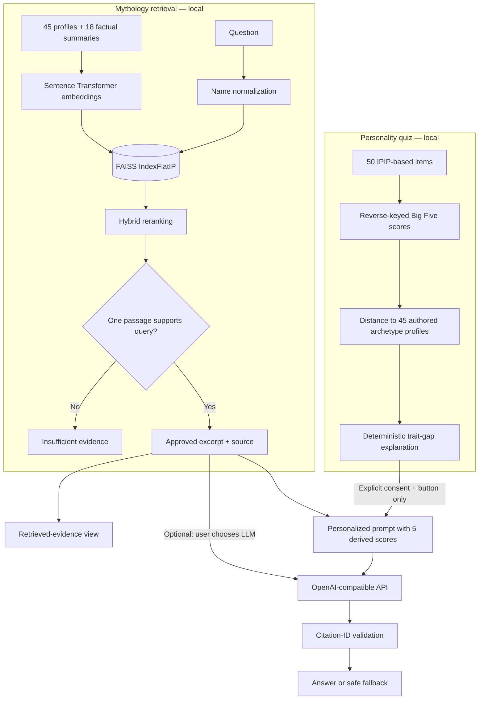

# Greek Mythology AI Personality Matcher

**A reproducible Python + Streamlit portfolio project combining a Big Five personality quiz with evidence-gated Greek mythology RAG and optional OpenAI explanations.**

The app has two experiences: a 50-item personality questionnaire that ranks 45 **manually designed** mythological archetypes, and a question-answering assistant that searches 63 short project-authored mythology documents. Both features run locally by default; hosted LLM generation is opt-in.

> **Important:** This is an educational, entertainment-oriented demonstration of AI engineering. Mythological trait vectors are subjective interpretations, **not measured personality characteristics**. The similarity index is **not a probability, psychological diagnosis or validated personality fit**. The knowledge base is intentionally small. Evidence gating and citation syntax checks **do not guarantee factual faithfulness**.

## Highlights

- **Deterministic quiz:** IPIP-based 50-item Big Five scoring, reverse-keyed questions, persistent per-session pagination, 45 curated deities, optional candidate-gender filtering.
- **Local retrieval:** `sentence-transformers/all-MiniLM-L6-v2` embeddings, FAISS cosine search, name typo normalization, hybrid reranking and a passage-level heuristic Evidence Gate.
- **Optional generation:** OpenAI-compatible chat generation conditioned on a **single approved passage**, with citation-ID validation and abstention on insufficient evidence.
- **Personalized explanations:** Five locally computed trait gaps, plus consent-based AI commentary on a selected match; raw questionnaire responses and gender are not sent to the provider.
- **Reproducible engineering:** Offline unit tests, retrieval benchmarks, GitHub Actions CI, a local release hygiene check and an optional **human** faithfulness review worksheet.

## Screens / user journeys

| Personality Quiz | Mythology Assistant |
|---|---|
| Choose matching preferences, complete 50 questions, compare your top three archetypes and see a transparent score-gap explanation. | Ask in English, inspect retrieved source snippets, optionally use a hosted LLM, and see insufficient-evidence abstentions. |

There are **no fabricated screenshots** in this repository. See [screenshot guidance](docs/SCREENSHOTS.md) to capture the running app before publishing images.

## Quick start — Windows PowerShell

Use **Python 3.11 or 3.12 (64-bit)**. Open PowerShell in the folder containing `app.py`:

```powershell
py -3.11 -m venv .venv
.venv\Scripts\python -m pip install -r requirements.txt
.venv\Scripts\python -m src.check_environment
.venv\Scripts\python -m src.rag.build_index
.venv\Scripts\python -m streamlit run app.py
```

If you have Python 3.12 instead, replace `py -3.11` with `py -3.12`. On Linux/macOS, use `python3 -m venv .venv` and `.venv/bin/python` in place of `.venv\Scripts\python`.

The **first** embedding-model use downloads Hugging Face weights; later runs use the local cache. An HF unauthenticated rate-limit warning is not a failure if indexing succeeds. No paid API key is required for the quiz or retrieved-evidence mode.

### Enable optional OpenAI responses

```powershell
Copy-Item .env.example .env
notepad .env
```

Place **`.env` in the project root next to `app.py`**, not in `.venv`. For a key from OpenAI itself:

```dotenv
OPENAI_API_KEY=your_actual_api_key
OPENAI_MODEL=gpt-4.1-mini
```

Leave `OPENAI_BASE_URL` unset for the official OpenAI API. The key must have API access/billing as applicable. **Never share or commit `.env`.** In Streamlit, use **Mythology RAG Chat → LLM answer**. You can also run:

```powershell
.venv\Scripts\python -m src.rag.ask --llm "How are Apollo and Artemis related?"
.venv\Scripts\python -m src.rag.ask --llm "What smartphone did Zeus use?"
```

The second prompt is expected to abstain on this corpus. Hosted API use may incur charges.

## How it works



The standard RAG chat **does not** send quiz scores. The personalized path sends five derived trait scores **only after the user explicitly consents**. See [architecture](docs/ARCHITECTURE.md) and [privacy details](docs/PRIVACY.md).

## Evaluation — observed local results

The project includes **41 small, hand-authored questions derived from its own corpus** (25 supported, 16 unsupported), divided into regression and challenge suites. On a recorded **Windows run (2026-11-10)**:

| Metric | Regression (13 + 6) | Challenge (12 + 10) |
|---|---:|---:|
| Hit@5 | 1.000 | 1.000 |
| MRR@5 — hybrid | 0.923 | 0.958 |
| MRR@5 — raw FAISS baseline | 0.727 | 0.861 |
| Evidence gate positive accept rate | 1.000 | 1.000 |
| Evidence gate negative reject rate | 1.000 | 1.000 |

The Evidence Gate correctly classified **41/41 examples on these particular suites**. These are **not independent, blind, or population-level performance estimates**, and do **not** measure faithfulness of actual LLM text. The legacy union-of-passages gate is an **ablation on current retrieval candidates**, not a separate historical-code rerun. See the full [evaluation methodology and observed results](docs/EVALUATION.md).

Reproduce on your own machine (after building the index):

```powershell
.venv\Scripts\python -m pytest -q
.venv\Scripts\python -m src.rag.evaluate --suite both --compare --output reports/local_retrieval.json
```

For **optional** generation review, run an explicit paid live audit, export a local CSV, then manually label supported/unsupported claims:

```powershell
.venv\Scripts\python -m src.rag.evaluate_generation --live --limit 7 --output reports/local_llm_audit.json
.venv\Scripts\python -m src.rag.faithfulness_review --input reports/local_llm_audit.json --csv reports/local_faithfulness_review.csv
.venv\Scripts\python -m src.rag.faithfulness_review --summary reports/local_faithfulness_review.csv
```

**Important:** The summary starts with no faithfulness percentage until answers are **manually rated**. These audit files may contain user questions and AI-generated output and are excluded from Git. See [review protocol](docs/FAITHFULNESS_REVIEW.md).

## Automated tests and CI

```powershell
.venv\Scripts\python -m pytest -q
.venv\Scripts\python -m tools.check_release
```

[`.github/workflows/ci.yml`](.github/workflows/ci.yml) runs the offline tests on Python 3.11 and 3.12, checks basic credential patterns, and compiles source. It installs a lightweight test dependency set instead of downloading the entire embedding model. Real network/provider behavior and the interactive UI need separate manual checks.

## Repository layout

```text
app.py                         Streamlit experience
src/assessment.py              IPIP questionnaire and 45-archetype matching
src/personalization.py         Deterministic score comparisons
src/rag/                      Embedding, FAISS, hybrid retrieval, gate and generation
data/archetype_profiles.json   45 author-assigned deity vectors
data/knowledge/curated_facts.json   18 short project-authored factual summaries
data/evaluation/              QA benchmark prompts
notebooks/                     Exploratory experiments
tests/                         Automated offline tests
.github/workflows/ci.yml       GitHub Actions checks
requirements.txt               Full local application dependencies
requirements-ci.txt            Lightweight offline CI dependencies
docs/                          Architecture, privacy, evaluation and learning guides
```

## Documentation

- [Architecture and design decisions](docs/ARCHITECTURE.md)
- [Benchmark protocol, limitations and results](docs/EVALUATION.md)
- [Human faithfulness review](docs/FAITHFULNESS_REVIEW.md)
- [Privacy, API data flow, security boundaries](docs/PRIVACY.md)
- [GitHub publication checklist](docs/GITHUB_PUBLISH.md)
- [Screenshots: how to capture real app views](docs/SCREENSHOTS.md)
- [personalized explanations learning guide](docs/PERSONALIZATION_GUIDE.md)

## Limitations and attribution

- The 45 deity vectors are **not learned from data** and have no psychometric validation; gender choices only filter candidate characters and never influence trait scoring.
- IPIP items intentionally include related/reverse-framed questions. Editing or removing them changes the scoring definition.
- Corpus summaries are written for this project. Source URLs are **background references**, not source-text quotations or claim-level evidence verification.
- The Evidence Gate is a **rule-based heuristic**, not a trained NLI/entailment model, and may fail on unusual, adversarial or multi-hop queries.
- Citation IDs prove only that a response points to an available excerpt, not that every claim is supported. Human checking is required for any factual claims.
- Model download and remote LLM use require internet access; remote providers may charge and process the data explicitly sent to them.

**References:** [IPIP item pool](https://ipip.ori.org/), [Theoi mythology directory](https://www.theoi.com/greek-mythology/greek-gods.html), [Sentence Transformers](https://www.sbert.net/), [FAISS](https://github.com/facebookresearch/faiss). An optional exploratory notebook prepares a separate third-party Greek-gods CSV and does **not** supply the 45 match vectors.

**License:** [MIT](LICENSE). If you use this project in a study, cite/credit the external mythology reference material and IPIP resources appropriately.
