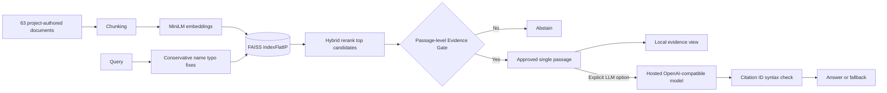

# Architecture and implementation notes

## Scope

Two user-facing experiences share a Streamlit shell but have different trust boundaries: a **deterministic** 50-item quiz and an evidence-gated Greek mythology knowledge assistant. There is **no trained personality classification model** in this project. RAG uses a pretrained text encoder for document and query embeddings, with a local FAISS index.

## Quiz path — local and deterministic

```text
app.py onboarding -> optional deity-candidate gender filter
    -> src.quiz_state: 50 session answers across five pages
    -> src.assessment.score_big_five: 5 normalized factors
    -> src.assessment.find_matches: normalized Euclidean distance
    -> src.personalization.explain_match: five per-trait differences
    -> local result UI (no network call)
```

The quiz uses public IPIP-style statements in published order; some intentionally refer to similar ideas or are reverse-keyed. The matcher compares those five scores against **45 author-assigned mythological profiles** and is explicitly illustrative. Traditional portrayal/gender filtering changes the candidate pool, **not** the five computed scores.

For each of the five traits `t`:

```text
distance = sqrt(sum((user[t] - archetype[t])**2 for t in five_traits) / 5)
similarity_index = round((1 - distance) * 100, 1)
```

This index is a display heuristic, **not calibrated probability** or scientific similarity.

## Retrieval path — local until opt-in



**Files to follow:** `src/rag/knowledge_base.py` → `text_chunker.py` → `embeddings.py` → `vector_store.py` → `retriever.py` + `query_normalizer.py` → `evidence_gate.py` → `answer_service.py` → `llm_client.py` + `grounding.py`.

**Corpus:** 45 short deity descriptions built from the profile JSON and 18 additional curated original summaries. `build_index.py` creates a local `data/rag_index` cache using the model name and document fingerprint. It should be rebuilt if data or encoder changes.

**Passage gate:** An auditable heuristic checks that **one** selected passage includes requested entities/concepts/intent. It handles some paraphrases but is **not an NLI model**, is not calibrated, and may make both false-accept and false-reject decisions. The model is instructed to use only that passage; after generation the system checks `[S1]` validity. This is **not claim-level fact checking**.

## Personalized opt-in path

- Streamlit displays the local explanation regardless of LLM connectivity.
- A remote call requires `OPENAI_API_KEY` + `OPENAI_MODEL`, checked consent and an explicit **Generate** click.
- A matching deity-specific excerpt must be approved first; otherwise **no provider call** occurs.
- The optional prompt contains: chosen deity/profile text, **five derived trait scores**, selected focus and typed question, and one project-authored excerpt.
- The raw 50 item-level responses and participant gender are **not** included. LLM output cannot modify quiz scores or rankings.

See [privacy and external-service boundaries](PRIVACY.md).

## Evaluation boundaries

`pytest` checks deterministic behavior using test doubles (fake LLM, fake embeddings). A FAISS unit test uses a tiny fake embedding model. Offline CI therefore has no model downloads and no API charges. The actual embedding model and GPU/CPU-dependent FAISS pipeline, interactive browser and real API requests must be separately checked in an end-to-end run.

The retrieval benchmark uses hand-curated, **corpus-derived** queries. A top-ranked hit and a citation identifier do not by themselves prove the model's generated claim is truthful. To explore this gap, use the optional [human faithfulness review](FAITHFULNESS_REVIEW.md).

## Known technical limitations

- Small fixed corpus; incomplete myth coverage; English-only query design and heuristic name normalization.
- No authenticated user identities, persistent progress, deployment auth or database. Session data disappears after session expiry.
- Hosted LLM handling depends on the configured provider; explicit consent and local `.env` are intended for local demo use, not a production multi-tenant privacy platform.
- `faiss.read_index` must only read locally generated trusted index files; do not load arbitrary untrusted index binaries.
